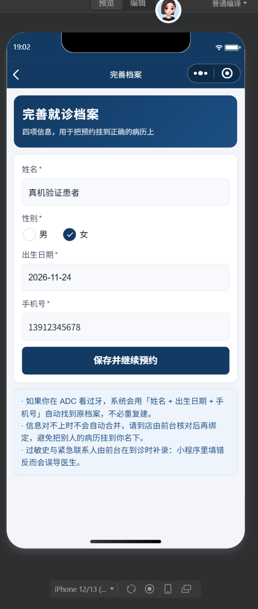
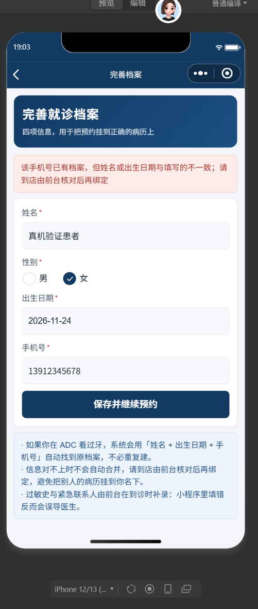
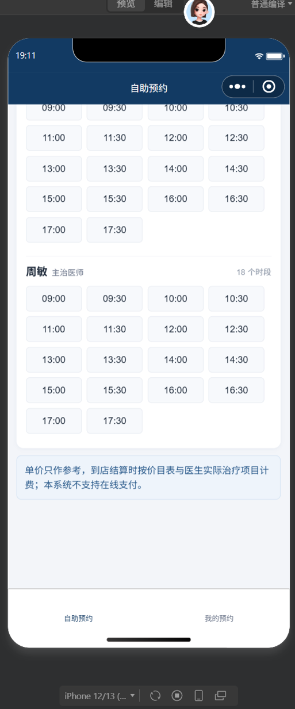
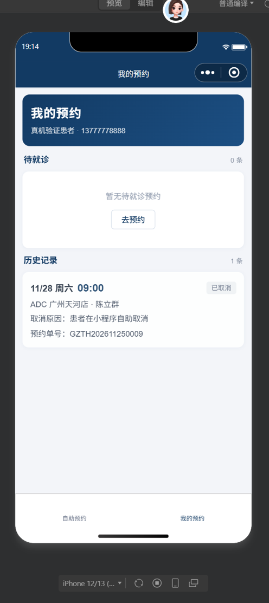

# ADC 牙科连锁信息管理系统 —— 演示操作指南

> 给老师/评审用。**不用装任何软件，打开浏览器就能操作。**
> 系统已部署在公网，报告见 [PDF 全文](%E4%BF%A1%E7%AE%A1T2401%E7%8F%AD%E9%A9%AC%E5%8D%9A%E6%99%A8.pdf)。

---

## 一、直接打开系统

**地址：<http://47.111.70.208:8080/>**

**登录口令：`123456`**（账号在登录页点一下就自动填好，口令也可以点「点击填入」）

建议使用 Chrome / Edge，窗口宽度 ≥ 1280px。
如果打开慢，云服务器是 2 核 2G 的小机器，首次加载几秒属正常。

---

## 二、登录

登录页有三个演示账号，点账号卡片会**自动填好账号和口令**，不用手敲。

| 账号 | 姓名 | 角色 | 能看到什么 |
| --- | --- | --- | --- |
| `linxiaoyu` | 林小雨 | 前台接待员 | 建档、预约、到诊登记、收费结算（**演示主用这个**） |
| `chenliqun` | 陈立群 | 牙医 | 只能看到分配给自己的到诊与治疗记录 |
| `zhengwei` | 郑维 | 总部管理者 | 九个窗体全开：资质、诊所、报表、审计等 |

**口令统一：`123456`**

> 这是课程演示用的简单口令，正式系统必须换成强口令。

三个角色权限不同，可以分别登录，验证「牙医看不到别人的患者」「前台不能改资质」这些权限控制。

---

## 三、建议的演示路线（5 分钟讲完一条完整业务链）

用 `linxiaoyu` 登录后，左侧菜单按下面顺序点：

1. **患者建档**（前台 → 患者档案）
   新建一个患者，填姓名、手机；系统会自动查重——再建一次同手机号会被拦下。
2. **受理预约**（前台 → 预约登记）
   选诊所1、日期、治疗项目，系统按牙医资质和排班给出可约时段；选定后生成预约单。
   **可约日期是滚动窗口：从当天起到下个月同一天**（例如 12/2 登录就能约到 1/2，
   1/15 登录就能约到 2/15——窗口随登录日自动顺延，不是写死的日期）。
   诊所1 每天 09:00–18:00 都有牙医排班，已铺一年；当天只显示当前时刻之后的时段。
   越界日期会被拒绝并提示"只能预约到 X（当天起一个月内）"。
3. **到诊登记**（前台 → 到诊登记台）
   把预约标记为"已到诊"，形成就诊记录。
4. **记录治疗**（换 `chenliqun` 登录 → 牙医工作台）
   牙医只能看到自己的到诊；录入治疗项目和消耗单位，系统按标准单价试算费用。
5. **收费结算**（换回 `linxiaoyu` → 收费台）
   生成结算单、收款；再演示一次红冲退款，会保留原单和红字单两条留痕。
6. **总部视角**（换 `zhengwei` 登录 → 报表/诊所/资质）
   看跨诊所的统一经营视图、季度业绩、资质有效期；这里能看到前面几步产生的数据已经汇总进来了。

**想看权限控制**：用 `chenliqun` 登录后试着点"资质维护"或"诊所管理"，会被拒绝（403）。

---

## 四、系统包含什么

| 层 | 技术 | 说明 |
| --- | --- | --- |
| 患者端 | 微信小程序（原生） | UC-10：登录、自助建档、选时段预约、我的预约、取消（24 小时闸）。见下方「小程序体验版」 |
| 员工端 | Vue 3 + TypeScript + Vite | 三个工作台、九个窗体，hash 路由 |
| 后端 | Spring Boot 3 + Java 21 + MyBatis | 10 个系统用例，BCrypt 口令 + 签名票据 + 角色准入 |
| 数据库 | PostgreSQL 16 | 21 张表（16 业务 + 5 技术支撑），Flyway 迁移 V1–V12 |
| 部署 | Docker Compose | nginx + Spring Boot + PostgreSQL 三容器，跑在阿里云 ECS（Ubuntu 22.04，2 核 2G） |

报告里的 10 个用例（UC-01 ~ UC-10）全部落地；四个接口冒烟脚本共 116 项断言全部通过。

---

## 五、源码结构

```
system/
├─ apps/
│  ├─ adc-api/     后端源码（pom.xml + src/）与 Flyway 迁移 V1–V10
│  ├─ adc-web/     员工端 Vue 源码
│  └─ adc-miniapp/ 患者端小程序源码
├─ deploy/         生产编排：Dockerfile.api / Dockerfile.web / nginx.conf / 备份恢复脚本
├─ docs/           接口冒烟脚本、接口清单
└─ SYSTEM.md       本文件
```

完整交接说明（环境、接口清单、已知坑、验收清单）见仓库里的 `HANDOVER.md`。

**源码**：仓库里的 [`system/`](system/) 目录可直接在线浏览（153 个源码文件）；
也可下载打包好的 [`ADC-system-source.zip`](ADC-system-source.zip)（161 个文件，含配置模板）。
`application.yml` 里的密钥是占位符，实际部署时需从环境变量或 `.env` 注入（模板见 `.env.example`）。
源码已排除依赖目录（node_modules / target）和真实密钥。

---

## 六、患者端小程序（可扫码体验）


**微信扫这张码就能用，扫码后不需要做任何设置。**

> **为什么不会卡在"网络异常"**：微信体验版只允许请求**已备案的 HTTPS 域名**，
> 而后端是明文 IP。本系统在小程序与后端之间加了一层**微信云开发云函数**
> （`system/apps/adc-miniapp/cloudfunctions/adcApi`）做透明转发——云函数调用走微信自有通道，
> **不校验域名白名单**，因此既不需要备案域名，也不需要打开调试。鉴权仍由后端判定，
> 云函数只转发 `/api/` 请求，不做任何业务处理。

> **扫码提示"不在体验名单中"**：让管理员在公众平台「管理 → 成员管理 → 体验成员」
> 添加你的微信号；新版也支持在弹窗里点「申请体验权限」，由管理员批准。
>
> **想换一位患者演示**：进「我的预约」→ 页面底部「**退出登录**」→ 重新填写另一位患者的档案即可。
>
> **二维码有效期约 7 天**（本张到 2026-12-05）。过期后到公众平台
> 「管理 → 版本管理 → 体验版」重新下载即可，不用重新上传代码。

患者端是微信小程序，实现 UC-10：**微信登录 → 自助建档（含查重） → 选时段预约 → 我的预约 → 取消（24 小时闸）**。

下面的截图来自**微信开发者工具「真机调试」模式、iPhone 实机运行**，连的是本系统的公网后端，
不是模拟器合成图：

| 步骤 | 界面 |
| --- | --- |
| ① 完善就诊档案 |  |
| ② 手机号已被占用时拦截并提示到店核对 |  |
| ③ 按牙医与时段选择（资质匹配后返回的结果） |  |
| ④ 我的预约：待就诊与历史记录，取消后留痕 |  |

> 若二维码已过期且暂时拿不到新的，老师也可用微信开发者工具导入 `system/apps/adc-miniapp`，
> 详情 → 本地设置 → 勾选「不校验合法域名」，再点「真机调试」用手机扫码（约 5 分钟）。

---

## 七、常见问题

**Q：为什么牙医登录看不到建档菜单？**
A：权限不同。牙医只能"到诊与治疗"，建档/预约/收费是前台职责，总部才有全部九个窗体。这是按报告 6.14 的三工作台口径做的。

**Q：预约时段为什么有些牙医选不了？**
A：系统按"治疗项目所需资质"和"牙医排班"过滤时段，资质不符或没排班的牙医不会出现。这是报告 UC-02 的核心规则。

**Q：取消预约为什么有时被拒？**
A：报告规定就诊前 24 小时内不能自助取消（小程序侧），前台侧可以取消但会留痕。

**Q：系统关机了怎么办？**
A：这是课程演示服务器，不保证长期在线。若打不开，等一会儿再试；源码和部署脚本都在仓库里，可自行重建。

---

## 八、注意

- 系统公网地址直接暴露，口令 `123456` 仅供课堂演示，请勿用于真实患者数据。
- 小程序已在 iPhone 真机上用「真机调试」走通全流程（见第六节四张实拍），代码已上传为体验版 `1.0.0`，二维码见第六节开头。个人主体做不了医疗类目，正式发布需企业资质。
